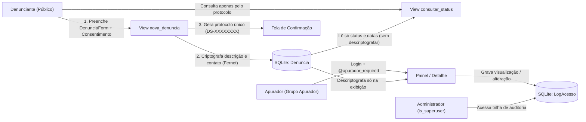
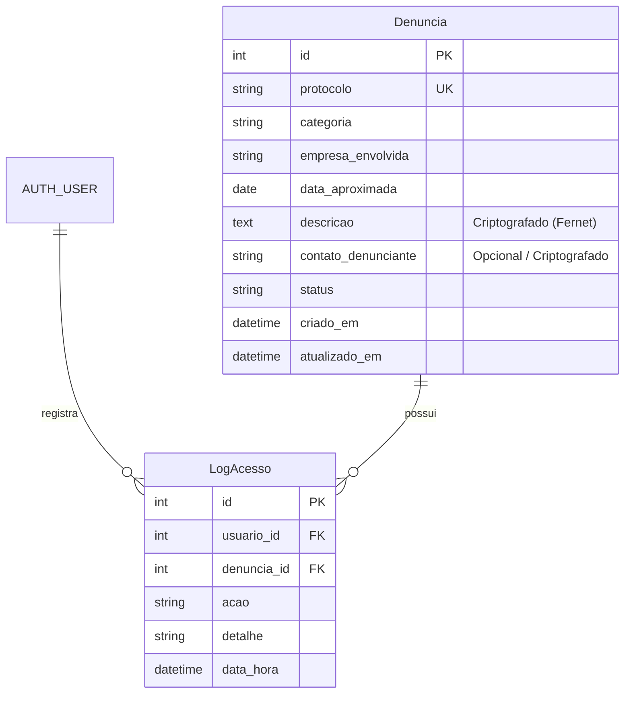

# DenúnciaSafe — Canal de Denúncias em Conformidade com a LGPD

Sistema web desenvolvido para o **Projeto Integrador VI-B**, voltado ao registro e acompanhamento de denúncias de vazamento de dados, práticas inadequadas de segurança e atividades suspeitas em empresas. O sistema foi projetado para ser, ele próprio, um exemplo prático de conformidade com a **Lei Geral de Proteção de Dados (Lei nº 13.709/2018 — LGPD)**.

## Tecnologias Utilizadas

- **Python 3** e **Django 5**
- **SQLite** (banco de dados local embutido)
- **cryptography (Fernet)** para criptografia simétrica em repouso
- **python-dotenv** para leitura de variáveis de ambiente a partir do `.env`

## Instalação

1. Crie e ative o ambiente virtual:
   ```powershell
   python -m venv venv
   .\venv\Scripts\Activate.ps1
   ```

2. Instale as dependências:
   ```powershell
   pip install -r requirements.txt
   ```

3. Configure a chave de criptografia no arquivo `.env` (baseado no `.env.example`):
   ```powershell
   Copy-Item .env.example .env
   python -c "from cryptography.fernet import Fernet; print('FERNET_KEY=' + Fernet.generate_key().decode())"
   ```
   Cole a chave gerada no campo `FERNET_KEY` do arquivo `.env`.

4. Aplique as migrações do banco de dados:
   ```powershell
   python manage.py migrate
   ```

5. Crie o grupo **Apurador** e um superusuário para testes:
   ```powershell
   python manage.py configurar_acessos
   python manage.py createsuperuser
   ```
   > **Dica:** Para automatizar a criação do superusuário de teste sem gravar senhas no repositório, defina `DJANGO_SUPERUSER_PASSWORD` no terminal antes de rodar `python manage.py configurar_acessos`, ou adicione o usuário criado ao grupo `Apurador` pelo `/admin/`.

## Como Rodar

Execute a verificação do projeto e inicie o servidor de desenvolvimento:

```powershell
python manage.py check
python manage.py runserver
```

Acesse no navegador:

- **Nova denúncia (pública):** `http://127.0.0.1:8000/`
- **Consultar protocolo (pública):** `http://127.0.0.1:8000/consultar/`
- **Política de Privacidade (LGPD):** `http://127.0.0.1:8000/privacidade/`
- **Login / Painel do Apurador:** `http://127.0.0.1:8000/login/` e `/painel/`
- **Trilha de Auditoria (Administrador):** `http://127.0.0.1:8000/painel/auditoria/`

## Perfis de Usuário

| Perfil | Autenticação | Permissões no Sistema |
| :--- | :--- | :--- |
| **Denunciante (Público)** | Não requer login | Pode registrar denúncias (de forma anônima ou com contato opcional), ler a Política de Privacidade e consultar apenas o status pelo número de protocolo. |
| **Apurador** | Login obrigatório + grupo `Apurador` | Acessa a lista de denúncias, visualiza detalhes descriptografados e atualiza o status (`Recebida`, `Em análise`, `Concluída`). |
| **Administrador** | Login obrigatório + `is_superuser` | Além das permissões administrativas do `/admin/`, acessa a tela de **Trilha de Auditoria** (`/painel/auditoria/`) com o histórico de visualizações e alterações. |

## Matriz de Conformidade com a LGPD

| Exigência da Lei (LGPD) | Requisito do Sistema | Implementação no Código |
| :--- | :--- | :--- |
| **Finalidade** (Art. 6º, I) e **Consentimento** (Art. 7º, I; Art. 8º) | Informar claramente o objetivo da coleta e obter aceite explícito antes do envio. | Campo obrigatório `consentimento` no `DenunciaForm` (`denuncias/forms.py`) com link direto para a Política de Privacidade (`denuncias/templates/denuncias/nova_denuncia.html`). |
| **Necessidade / Minimização** (Art. 6º, III) | Coletar apenas o essencial, permitindo anonimato total e evitando exposição na consulta pública. | Campo `contato_denunciante` opcional em `Denuncia` (`denuncias/models.py`); view `consultar_status` (`denuncias/views.py`) retorna somente protocolo, status e datas. |
| **Transparência** (Art. 6º, VI) | Explicar em linguagem clara finalidade, minimização, segurança e retenção. | Página dedicada `/privacidade/` (`denuncias/templates/denuncias/politica_privacidade.html`). |
| **Segurança e Prevenção** (Art. 6º, VII e VIII; Art. 46) | Proteger dados sensíveis em repouso e restringir o acesso ao conteúdo. | Criptografia Fernet em `descricao` e `contato_denunciante` (`denuncias/crypto.py`) com chave em `.env`; descriptografia apenas em `detalhe_denuncia` protegida pelo decorator `@apurador_required` (`denuncias/decorators.py`). |
| **Responsabilização e Prestação de Contas** (Art. 6º, X) | Registrar quem acessou ou alterou cada denúncia e quando. | Model `LogAcesso` (`denuncias/models.py`) gravado automaticamente em `detalhe_denuncia` e exibido na tela `/painel/auditoria/` para o administrador. |

## Mapa do Projeto (Estrutura de Arquivos)

```text
NovoP.i/
├── .env.example                  # Modelo de variáveis de ambiente (sem chaves reais)
├── .gitignore                    # Impede versionamento de .env, db.sqlite3 e venv/
├── manage.py                     # Utilitário de linha de comando do Django
├── requirements.txt              # Dependências Python (Django, cryptography, python-dotenv)
├── README.md                     # Documentação e mapas do sistema
├── denunciasafe/                 # Configurações centrais do projeto Django
│   ├── settings.py               # Leitura do .env (FERNET_KEY), SQLite, idioma e autenticação
│   └── urls.py                   # Roteamento principal (/admin/ e app denuncias)
└── denuncias/                    # Aplicação principal de denúncias
    ├── admin.py                  # Registro de Denuncia e LogAcesso (somente leitura) no Admin
    ├── crypto.py                 # Funções de criptografia e descriptografia Fernet
    ├── decorators.py             # Decorator @apurador_required (controle por grupo)
    ├── forms.py                  # DenunciaForm (com consentimento), ConsultaProtocoloForm, AlterarStatusForm
    ├── models.py                 # Models Denuncia (protocolo único) e LogAcesso (auditoria)
    ├── urls.py                   # Rotas públicas e restritas do app
    ├── views.py                  # Lógica das páginas, criptografia/descriptografia e auditoria
    ├── management/commands/
    │   └── configurar_acessos.py # Comando para criar grupo "Apurador" e superusuário via env
    ├── migrations/               # Migrações do banco SQLite
    └── templates/
        ├── 403.html              # Página de acesso negado para usuários fora do grupo Apurador
        └── denuncias/
            ├── base.html         # Layout base e barra de navegação
            ├── nova_denuncia.html
            ├── confirmacao.html
            ├── consultar_status.html
            ├── politica_privacidade.html
            ├── login.html
            ├── lista_denuncias.html
            ├── detalhe_denuncia.html
            └── logs_auditoria.html
```

## Mapa de Rotas (URLs)

| Rota | Nome da URL | Acesso | Descrição |
| :--- | :--- | :--- | :--- |
| `/` | `nova_denuncia` | Público | Formulário de envio de denúncia com aceite obrigatório de consentimento. |
| `/confirmacao/<protocolo>/` | `confirmacao_denuncia` | Público | Exibe o código de protocolo único gerado após o envio. |
| `/consultar/` | `consultar_status` | Público | Consulta de andamento pelo protocolo (sem exibir relato ou contato). |
| `/privacidade/` | `politica_privacidade` | Público | Política de Privacidade em linguagem clara (LGPD). |
| `/login/` | `login` | Público | Tela de autenticação para apuradores e administradores. |
| `/logout/` | `logout` | Autenticado | Encerra a sessão do usuário (via POST). |
| `/painel/` | `lista_denuncias` | Grupo `Apurador` | Lista de denúncias com filtro por status. |
| `/painel/denuncia/<id>/` | `detalhe_denuncia` | Grupo `Apurador` | Exibe dados descriptografados, permite alterar status e grava `LogAcesso`. |
| `/painel/auditoria/` | `logs_auditoria` | Administrador (`is_superuser`) | Consulta cronológica da trilha de auditoria (`LogAcesso`). |
| `/admin/` | `admin:index` | Staff / Administrador | Painel administrativo padrão do Django. |

## Mapa de Fluxo de Dados e Segurança



## Modelo de Dados (Relacionamento)


